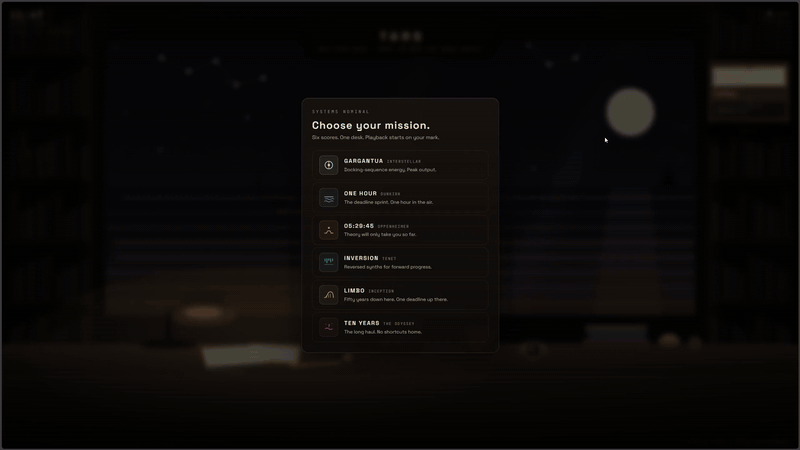

<p align="center">
  
</p>

<p align="center">
  <a href="https://www.youtube.com/@vijai_sundaram"></a>
  <a href="https://www.linkedin.com/in/vijay-sundaram/"></a>
  <a href="https://x.com/VijaySundaram_"></a>
  
  
  
</p>

---

## Deep-focus radio for work that needs gravity.

TARS is a single-page radio that plays the scores from Christopher Nolan's films while you work. You sit at an illustrated desk in front of a huge observation window, pick a station, and the view through the window changes with the film. Keep the tab open, get on with your day.

<p align="center">
  <a href="LIVE_SITE_URL"><b>🚀 Try it live</b></a>
</p>

---

## Demo

<p align="center">
  
</p>

<p align="center">
  <a href="YOUTUBE_VIDEO_URL">▶️ Watch the demo on YouTube</a>
</p>

---

## Stations

| Station | Film | Mood |
|---------|------|------|
| **GARGANTUA** | Interstellar | Docking-sequence energy. Peak output. |
| **ONE HOUR** | Dunkirk | The deadline sprint. One hour in the air. |
| **05:29:45** | Oppenheimer | Theory will only take you so far. |
| **INVERSION** | Tenet | Reversed synths for forward progress. |
| **LIMBO** | Inception | Fifty years down here. One deadline up there. |
| **TEN YEARS** | The Odyssey | The long haul. No shortcuts home. |

---

## Features

- **One room, six windows** - switching stations crossfades only the view outside; the desk stays yours
- **A desk that reacts** - the lamp, the props and the wristwatch all behave differently depending on the film
- **Small focus tools** - a session timer, a sleep timer, and a pinned note asking why you're here
- **Honest playback** - full official albums through the YouTube embed; no fake listener counts, no controls that pretend to work
- **Original artwork** - everything is hand-built SVG and CSS, and it works on phones, tablets and desktops
- **A few secrets** - the room rewards poking around. No spoilers here.

---

## Tech Stack

| Tool | Purpose |
|------|---------|
| Next.js 16 (App Router) + TypeScript | Single static page, no backend |
| Tailwind CSS v4 | Styling |
| SVG + CSS animation | The entire illustrated scene |
| YouTube IFrame Player API | All playback, via official embeds |
| localStorage | Remembers your station and mission note |

---

## Run It Locally

No API keys or environment variables needed.

```bash
git clone https://github.com/v1jaysundaram/tars.git
cd tars
npm install
npm run dev
```

Open [http://localhost:3000](http://localhost:3000).

Want different music? Every playlist lives in one file: `src/data/stations.ts`.

---

## Why I Built This

Similar stuff was trending online on Twitter and I just wanted to give it a try, but with my own spin - one theme. Nothing special about it. It was more of a fun project.

---

## Disclaimer

Unofficial fan project. Not affiliated with any studio, composer or label. All scores © their composers and labels, played via official YouTube embeds - nothing is hosted, downloaded or proxied. No logos, film stills or poster art are used; all artwork is original.

---

## License

MIT © Vijay Sundaram Mohana

---

## Connect

If you enjoyed this, a ⭐ on the repo goes a long way.

<p align="left">
  <a href="https://www.youtube.com/@vijai_sundaram">YouTube</a> &nbsp;·&nbsp;
  <a href="https://www.linkedin.com/in/vijay-sundaram/">LinkedIn</a> &nbsp;·&nbsp;
  <a href="https://x.com/VijaySundaram_">X</a>
</p>
